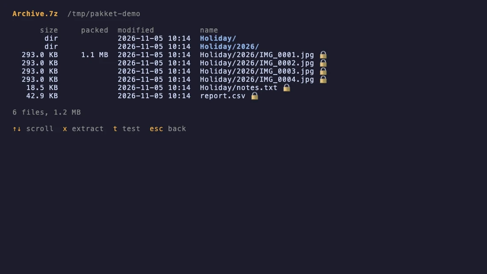

<div align="center">

# pakket

A file archiver for the terminal: compress, extract, encrypt, list and test archives in dozens of formats, from a keyboard-driven file browser or from scripts. It covers what the Keka app does, in a terminal.

[Features](#features) · [Install](#install) · [Use it](#use-it) · [Formats](#formats) · [Keys](#keys) · [Settings](#settings) · [Compared with Keka](#compared-with-keka) · [How it works](#how-it-works) · [Limits](#limits) · [Contributing](#contributing)


</div>

<!-- live-links -->
**Project page:** [gitguy268.github.io/pakket](https://gitguy268.github.io/pakket/)
<!-- /live-links -->

<!-- run-steps:start -->
## Run it locally, step by step

1. **Install it with [Homebrew](https://brew.sh)** (macOS or Linux). This also installs 7-Zip. Homebrew asks you to trust a tap once:

   ```sh
   brew trust gitguy268/tap
   brew install gitguy268/tap/pakket
   ```

   Or build it yourself: install [Go](https://go.dev/dl/) 1.27 or newer and 7-Zip (`brew install sevenzip`, or `sudo apt install 7zip`), then:

   ```sh
   git clone https://github.com/Gitguy268/pakket.git
   cd pakket
   go build -o pakket .
   ```

2. **Open the file browser** in any folder:

   ```sh
   pakket
   ```

3. **Pick files** with the arrow keys and `space`, press `c` to compress or `x` to extract, set the options and press **Compress** or **Extract**. Press `?` for every key, `q` to quit.

4. **Or script it:**

   ```sh
   pakket compress -f zip -p secret Photos/      # AES-256 zip
   pakket extract archive.rar                     # next to the archive
   pakket formats                                 # what works on this machine
   ```
<!-- run-steps:end -->

## Features

- **Create 25 formats:** 7z, zip, tar, tar.gz, tar.bz2, tar.xz, tar.zst, tar.br, tar.lz4, tar.lz, tar.lzma, the same codecs on single files, dmg, iso, wim, Apple Archive (aar), lrzip and age.
- **Extract 50+ extensions:** everything above plus rar, zipx, cab, msi, exe installers, deb, rpm, xar and pkg, xip, cpio and cpgz, pax, jar, war, ipa, apk, appx, xpi, epub, Z, arj, lzh, chm, vhd, vmdk, squashfs, Synology spk and WordPress wpress. With [unar](https://theunarchiver.com/command-line) also StuffIt, Compact Pro and InstallShield 3.
- **Encryption:** AES-256 7z with encrypted file names, AES-256 zip (or legacy ZipCrypto for old unzip tools), AES-256 disk images, and [age](https://age-encryption.org) for any file or folder, with a passphrase or public keys.
- **Passwords done carefully:** typed with no echo, passed to 7-Zip and `hdiutil` through stdin rather than the command line, optionally saved in and looked up from the macOS Keychain, and asked for again when one is wrong.
- **Keka's options:** compression level 0 to 9, solid 7z, split into volumes (CD, DVD, FAT32 and email presets or any size), one archive per item, exclude `.DS_Store`, `._` files and `__MACOSX`, delete originals or the archive afterwards (to the Trash; on Linux through `gio` or `trash-cli`, else deleted), volume names for dmg and iso, MD5 or SHA-256 checksum files, and an optional password text file.
- **Sensible extraction:** a folder only when the archive holds more than one item, no `x/x` double folders, `name 2` instead of overwriting, the download quarantine flag copied to the contents so Gatekeeper still checks apps, garbled names in old zips fixed (CP437, Shift-JIS, GBK, Big5 and more), split volumes joined from any part, and a `.tar` inside a 7z or age file unpacked too.
- **Safe by default:** entries that would land outside the destination, through `../`, absolute paths or symlinks, are refused; everything is extracted into a hidden temporary folder first and moved into place only when it succeeds.
- **A real TUI:** file browser with multi-select and filter, option forms, a job queue with progress bars and cancel, a contents view, and "Save as default".
- **Script-friendly:** subcommands with short flags, `--json` listings, exit codes, `PAKKET_PASSWORD`, quiet mode, and Keka's drop behaviour: `pakket <files>` extracts archives and compresses everything else.

<p align="center"></p>

## Install

| How | Command |
|---|---|
| Homebrew (macOS, Linux) | `brew trust gitguy268/tap && brew install gitguy268/tap/pakket` |
| Go | `go install github.com/Gitguy268/pakket@latest`, then `brew install sevenzip` or `apt install 7zip` |
| From source | see [Run it locally](#run-it-locally-step-by-step) |

Optional extras: `brew install unar` (StuffIt, Compact Pro, InstallShield) and `brew install lrzip` (lrz). `pakket formats` shows what is available.

## Use it

```sh
pakket                                   # file browser in the current folder
pakket Photos report.pdf                 # compress with your defaults (7z unless changed)
pakket download.zip                      # an archive: extract it

pakket compress -f 7z -P Photos/         # ask for a password, encrypt names too
pakket c -f tar.zst -l 9 project/        # short command and flags
pakket c -f zip --split 650m big-folder/ # big-folder.zip.001, .002, ...
pakket c -s -f gz *.log                  # one .gz per file
pakket c -f dmg --volume-name Backup -p secret Documents/
pakket encrypt -r age1... secrets.txt    # age, to a public key
pakket encrypt notes/                    # age, asks for a passphrase

pakket extract -d ~/Desktop *.rar        # several archives
pakket x --folder always --delete a.7z   # always a folder, archive to Trash
pakket x -e shift_jis old.zip            # Japanese names from an old Windows zip
pakket x big-folder.zip.002              # any volume of a split archive
pakket decrypt -i ~/.age/key.txt file.tar.age

pakket list archive.7z                   # sizes, packed sizes, dates, encryption
pakket list --json archive.iso | jq '.[].name'
pakket test *.zip                        # check CRCs; exit code 1 if one fails
pakket keychain save archive.7z          # remember a password for this archive
```

<details>
<summary><b>All compress options</b></summary>

| Flag | Meaning |
|---|---|
| `-f, --format` | output format, see [Formats](#formats) |
| `-l, --level 0-9` | 0 stores only, 9 is maximum compression |
| `-p, --password`, `-P, --ask-password` | encrypt (7z, zip, dmg, age); also `$PAKKET_PASSWORD` |
| `--show-names` | 7z: leave file names readable |
| `--zip-legacy` | zip: ZipCrypto instead of AES-256 |
| `--no-solid` | 7z: non-solid |
| `--keep-mac` | keep `.DS_Store`, `._` files and `__MACOSX` |
| `-x, --exclude GLOB` | skip matching names, repeatable |
| `-s, --separate` | one archive per input |
| `--delete` | move the originals to the Trash afterwards |
| `--split SIZE` | volumes such as `100m`, `700m`, `4.7g` |
| `-o, --output`, `-d, --dest`, `-n, --name` | where the archive goes and what it is called |
| `--volume-name` | dmg and iso volume name |
| `--checksum md5\|sha256` | write `<archive>.md5` or `.sha256` |
| `--export-password` | write the password to `<archive>.txt` |
| `--keychain` | save the password in the macOS Keychain |
| `-r, --recipient` | age public key or key file, repeatable |
| `--overwrite` | replace an existing archive |
| `--threads N` | 7-Zip threads |
| `--notify` | desktop notification when done |
| `-q, --quiet` | no progress bar |

</details>

<details>
<summary><b>All extract, list and test options</b></summary>

| Flag | Meaning |
|---|---|
| `-d, --dest` | where to extract (default: next to the archive) |
| `--folder smart\|always\|never` | smart makes a folder only for several items |
| `-p, --password`, `-P, --ask-password` | password; also `$PAKKET_PASSWORD` |
| `--no-keychain` | do not look up a stored password |
| `--delete` | move the archive and its volumes to the Trash afterwards |
| `--no-quarantine` | do not copy the quarantine flag to the contents |
| `-e, --encoding` | names in old zips: `auto`, `cp437`, `shift_jis`, `gbk`, `big5`, `euc-kr`, `cp866`, `windows-1251`, ... |
| `--overwrite rename\|overwrite\|skip` | what to do with existing items |
| `--ignore-gz-name` | name a `.gz` result after the archive, not the stored name |
| `--no-nested` | leave a `.tar` inside a 7z, lrz or age file packed |
| `-i, --identity` | age identity (private key) file, repeatable |
| `--json` | `list` only: JSON output |
| `--notify`, `-q, --quiet` | as for compress |

</details>

## Formats

Run `pakket formats` to see the same table for your machine, with anything missing marked.

| Format | Create | Extract | Password | Made by |
|---|:-:|:-:|:-:|---|
| 7z | ✓ | ✓ | AES-256, names too | 7-Zip |
| zip | ✓ | ✓ | AES-256 or ZipCrypto | Go; 7-Zip when encrypted |
| tar, tar.gz/bz2/xz/zst/br/lz4/lz/lzma | ✓ | ✓ | | Go |
| gz, bz2, xz, zst, br, lz4, lz, lzma | ✓ | ✓ | | Go (folders become `.tar.*`) |
| age | ✓ | ✓ | passphrase or keys | Go |
| dmg | ✓ macOS | ✓ | AES-256 | `hdiutil` (7-Zip on Linux, read only) |
| iso | ✓ macOS | ✓ | | `hdiutil makehybrid` (UDF, ISO 9660, Joliet); 7-Zip to read |
| wim | ✓ | ✓ | | 7-Zip |
| aar (Apple Archive) | ✓ macOS | ✓ macOS | | `aa` |
| lrz | ✓ | ✓ | | `lrzip`, optional |
| rar, cab, msi, exe, deb, rpm, xar/pkg, cpio, Z, arj, lzh, chm, vhd, vmdk, squashfs, zipx | | ✓ | when the format has one | 7-Zip |
| jar, war, ipa, apk, appx, xpi, epub, cbz, whl | | ✓ | | Go (they are zips) |
| xip | | ✓ macOS | | `xip` |
| cpgz, pax, spk, wpress | | ✓ | | Go (+ 7-Zip for cpio) |
| sit, sitx, cpt, is3 | | ✓ | | `unar`, optional |

## Keys

| Where | Keys |
|---|---|
| Browser | `↑↓`/`jk` move · `enter`/`→` open folder or view archive · `←`/`⌫` parent · `~` home · `space` select · `a` all · `esc` clear · `.` hidden files · `/` filter · `r` refresh |
| Actions | `c` compress · `x` extract · `e` encrypt (age) · `v` contents · `t` test · `tab` queue · `?` help · `q` quit |
| Forms | `↑↓`/`tab` move · `←→`/`space` change · type into text fields · `enter` next or press · `esc` back |
| Queue | `↑↓` move · `d` cancel or remove · `p` enter a password · `o` show in Finder · `C` clear finished |

## Settings

Defaults live in `~/.config/pakket/config.json` (or `$XDG_CONFIG_HOME/pakket`). Change them with **Save as default** in the TUI, or:

```sh
pakket config                       # show all
pakket config set format zip
pakket config set level 9
pakket config set folder always
pakket config set notify true
pakket config keys                  # every setting name
pakket config reset
```

Out of the box: 7z, level 5, solid, encrypted names, Mac junk excluded, smart folders, quarantine kept, Keychain lookup on.

## Compared with Keka

pakket follows the feature list Keka documents on [keka.io](https://www.keka.io) and in its [wiki](https://github.com/aonez/Keka/wiki). It is an independent project, not affiliated with Keka.

| Keka | pakket |
|---|---|
| Create 7z, zip, tar, gzip, bzip2, xz, lzip, dmg, iso, brotli, zstd, lrzip, aar, wim | all of these, plus lz4, lzma and age |
| Extract 33 formats incl. rar, exe, cab, msi, xip, cpgz, wpress, cpt, spk | all of these (cpt and is3 through `unar`), plus deb, rpm, vhd, squashfs and more |
| AES-256 7z with encrypted names; zip legacy by default, AES-256 as a hidden setting | the same, with AES-256 the zip default and `--zip-legacy` to switch |
| Split, solid, exclude resource forks, archive separately, delete after | same flags and toggles |
| ExportPassword and CalculateMD5 hidden settings | `--export-password`, `--checksum md5` (or sha256) |
| Drag files onto the Dock icon or window | `pakket <files>`, or the TUI browser |
| Finder context menu and default-app integration | not built in: see [Limits](#limits) |
| | Keychain password storage, age encryption, JSON listings, integrity test, scripts |

## How it works

<details>
<summary><b>Engine, external tools and safety</b></summary>

- **Detection** reads the first 32 KB: magic numbers for 7z, rar, zip, xz, zstd, lz4, lzip, gzip, bzip2, xar, cab, OLE (msi), age, lrzip, cpio, deb, rpm, Z, squashfs, Apple Archive, StuffIt, tar (`ustar` at 257), ISO (`CD001` at 32769) and the UDIF `koly` trailer of a dmg. The file name then picks the specific type within a family (jar vs zip, cpgz vs gz, pkg vs xar).
- **Pure Go** handles tar, zip without a password, every stream codec and age, so these work with no other program installed. Codecs: `klauspost/compress` (gzip, zstd, deflate), `ulikunitz/xz` (xz, lzma), `dsnet/compress` (bzip2 writer), `pierrec/lz4`, `andybalholm/brotli`, `sorairolake/lzip-go`, `filippo.io/age`.
- **7-Zip** (`7zz`) runs as a separate process for 7z, wim, encrypted zips and the read-only formats. pakket follows its progress (`-bsp1`) and gives it passwords on stdin: `-p` with stdin when creating, and the prompt answer when reading.
- **macOS tools:** `hdiutil` makes and opens disk images (HFS+, zlib/LZFSE/LZMA by level, AES-256 with `-stdinpass`); `hdiutil isencrypted` runs first so it never opens a password dialog. `aa` makes Apple Archives, `xip` expands xip files, `ditto` copies from a mounted image keeping metadata, `trash` moves to the Trash, `security` talks to the Keychain.
- **Staging:** dmg, iso and aar need a folder, so pakket builds one with APFS clones (`cp -c`), which takes no extra disk space on APFS, and removes Mac junk there.
- **Extraction** always goes into `.pakket-x-*` inside the destination. Each name is cleaned, kept inside that folder and checked so no parent is a symlink; hard links must point inside too. Only after success are the items moved into place, with `name 2` for clashes.
- **Split volumes** are written as `name.ext.001`, `.002`, ... while compressing (7-Zip splits its own), and read back as one stream, or joined into a temporary file for formats that need to seek (zip, dmg).

</details>

## Limits

- **No Finder integration yet.** Keka adds context-menu services and can be the default app for archives; pakket is a terminal program. You can call it from a Shortcut or an Automator Quick Action ("Run Shell Script": `/opt/homebrew/bin/pakket "$@"`).
- **dmg, iso and aar creation need macOS** (`hdiutil` and `aa`); on Linux, iso and dmg can be read through 7-Zip.
- **RAR is extract only**, as in Keka: the RAR format can only be created by WinRAR.
- **Delete-after on Linux** uses the desktop Trash through `gio trash` or `trash-put`; on a server with neither, files are deleted for good.
- **Passwords for `unar` and the Keychain** go on their command lines, because those tools do not read them from stdin; another local user could see them in `ps` for a moment.
- **ZipCrypto** (`--zip-legacy`) is weak and only for old unzip tools; the AES-256 default needs a modern tool (7-Zip, Keka, The Unarchiver, `unzip` does not support it).
- **Tested** on macOS 27 (arm64) with 7-Zip 26.05; Linux is covered by CI on Ubuntu.

## Contributing

Bug reports, format samples (that hold nothing private) and pull requests are welcome. See [CONTRIBUTING.md](CONTRIBUTING.md); report security problems privately as described in [SECURITY.md](SECURITY.md).

## License

[MIT](LICENSE) © 2026 Lucas Van De Weerd. Third-party code and the programs pakket runs are listed in [NOTICE](NOTICE). 7-Zip is LGPL and runs as a separate program. pakket is not affiliated with Keka or aONe.
